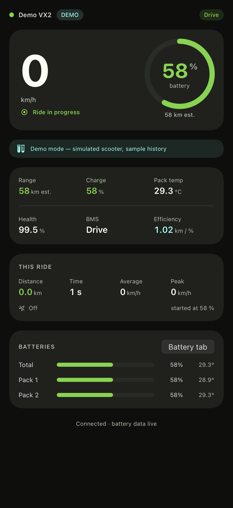
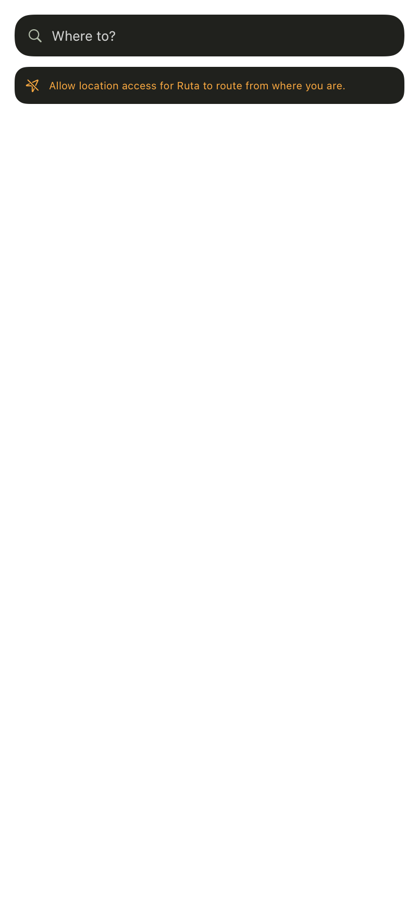
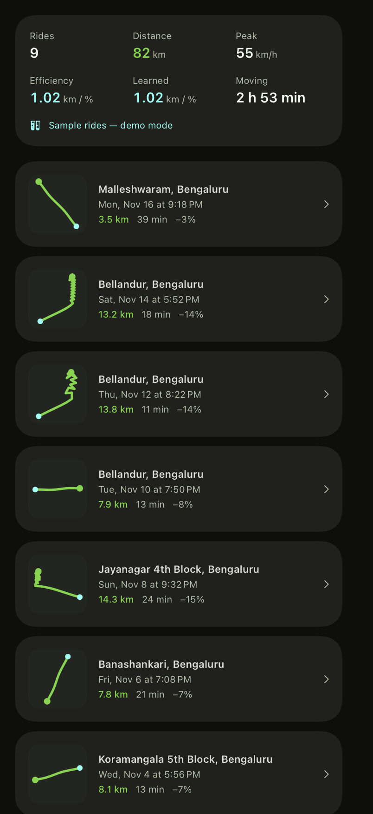
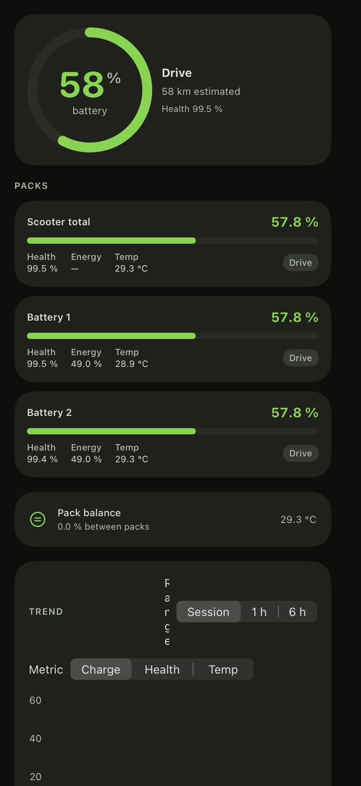
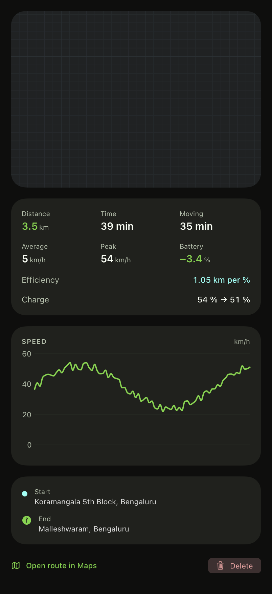

# Ruta for iOS

An iOS companion app for Vida electric scooters, ported in Swift from the open-source Android app
[CODESURGEN/ruta](https://github.com/CODESURGEN/ruta). Live battery for both packs, rides with GPS
tracks, learned range, and turn-by-turn mirrored to the scooter's cluster — with the same BLE
protocol, byte for byte.

<p>
  
  
  
  
  
</p>

## Status

Built in three days without an iPhone or a scooter on hand. What is verified, and how:

| Layer | Verified by |
|---|---|
| BLE protocol (frames, parsers, text codec) | Byte-exact test vectors ported from the Android app's Kotlin tests — `swift run RutaTests` |
| Link state machine, GATT setup, reconnect, heartbeat, BMS fallback | Simulated transport tests (`FakeScooterTransport`) |
| Ride math, range learning, charge detection, nav countdown, road names | Ported Android unit tests |
| Every screen, rendered at iPhone size | `swift run RutaSnapshot` (macOS, no Xcode needed) — the PNGs above |
| iOS app compiles for device + simulator | GitHub Actions workflow (`.github/workflows/ios.yml`) |

**Not yet verified on real hardware:** the Bluetooth pairing PIN flow, background BLE while the
phone locks, and the scooter's responses outside VX2. The friend-facing test script is
[`docs/TESTING.md`](docs/TESTING.md).

## What works

- **Live battery** — scooter total and both packs: charge, health, energy, temperature, state,
  pack balance, charge alerts (80/90/100 %), charge ETA.
- **Rides** — recorded from GPS with ignition/movement start rules, thinned tracks, place names via
  reverse geocoding, speed charts, per-ride battery use, delete, open route in Maps.
- **Range** — learned km-per-% from your rides and a live range estimate.
- **Navigation** — search a place, drive the route in-app on Apple Maps, and the next turn, distance
  to it, road name and arrival time are sent to the scooter's cluster with a live countdown.
- **Diagnostics** — a timestamped frame log, exportable as text from the More tab.
- **Demo mode** — a simulated scooter and sample rides, so everything is explorable without
  hardware.

## What is different from the Android app

iOS simply does not allow three things the Android app does, so this port does not pretend:

- **Calls** — no app can read another app's call state or answer/reject from a button. Handlebar
  call buttons are logged in Diagnostics, nothing more.
- **Music** — no supported API for other apps' now-playing. Same: logged only.
- **Navigation source** — the Android app reads a Google Maps notification. iOS forbids that, so
  Ruta runs its own MapKit guidance screen; the cluster mirroring is identical.

## Repo layout

```
Sources/RutaCore      protocol, session, transports, recorder, math, stores (no UI)
Sources/RutaUI        SwiftUI screens, models, theme
Sources/RutaPreview   macOS app running the whole UI with the fake scooter (swift run RutaPreview)
Sources/RutaSnapshot  renders every screen to PNGs (swift run RutaSnapshot)
Tests/RutaTests       ported Android test vectors + session/recorder suites (swift run RutaTests)
App/                  the iOS app shell (entry point + Info.plist)
project.yml           XcodeGen spec; the generated Ruta.xcodeproj is committed
docs/                plan, test script, screenshots
```

## Building and running on a Mac (no Xcode needed)

```bash
swift build
swift run RutaTests        # protocol + logic tests, prints "all checks passed"
swift run RutaPreview     # the full app with a simulated scooter in a macOS window
swift run RutaSnapshot    # writes docs/screenshots/*.png
```

## Building the iPhone app

The easiest route is CI: the workflow builds the app for the simulator and an unsigned device IPA,
and uploads both as artifacts. Grab `Ruta-unsigned-ipa-<full-sha>` from the latest successful
`main` run; the artifact includes the IPA, its SHA-256 and the exact commit.

To build locally (any Mac with Xcode 16+):

```bash
xcodegen generate   # only if you changed project.yml; the project is committed
open Ruta.xcodeproj # select your team in Signing & Capabilities, then Run
```

Or from the command line:

```bash
xcodebuild -project Ruta.xcodeproj -scheme Ruta \
  -destination 'generic/platform=iOS' -configuration Release \
  CODE_SIGNING_ALLOWED=NO build
```

### Putting it on an iPhone

| Method | Cost | Notes |
|---|---|---|
| Sideloadly / AltStore + free Apple ID | free | re-signs the unsigned IPA; refresh every 7 days — see [`docs/INSTALL.md`](docs/INSTALL.md) |
| Xcode → device | free | needs the Mac and the iPhone together, 7-day resign |
| TestFlight | $99/yr Apple Developer | smoothest delivery, but needs a separately signed Xcode 26+ build; the unsigned CI IPA is not directly uploadable |

## Pairing (read this first)

The scooter's BLE link requires bonding with a 4–8 digit PIN — the one the official Vida app uses.
On iOS the pairing sheet is shown by the system, not the app:

1. Turn the scooter on, close the official app completely.
2. In Ruta: Connect → Scan → pick the `HMC…` scooter.
3. iOS shows its Bluetooth pairing sheet. Enter the PIN. Ruta never sees it; iOS remembers it.

If no sheet appears, forget the scooter in Settings › Bluetooth and scan again. This PIN flow is
the one part of the port that no simulator can prove — see `docs/TESTING.md` for the nRF Connect
pre-flight check that settles it in two minutes.

## Privacy

Everything stays on the iPhone: rides, charges, settings, diagnostics. The only network use is
Apple Maps (destination search, routes) and the system geocoder for ride place names. No analytics,
no accounts, no scooter cloud.

## License and attribution

Apache-2.0 (see `LICENSES/Ruta-LICENSE` and `NOTICE`). This is an independent port of
[CODESURGEN/ruta](https://github.com/CODESURGEN/ruta); it is not affiliated with, endorsed by or
supported by Hero MotoCorp Ltd. or Vida, and contains none of their code, logos or assets.
